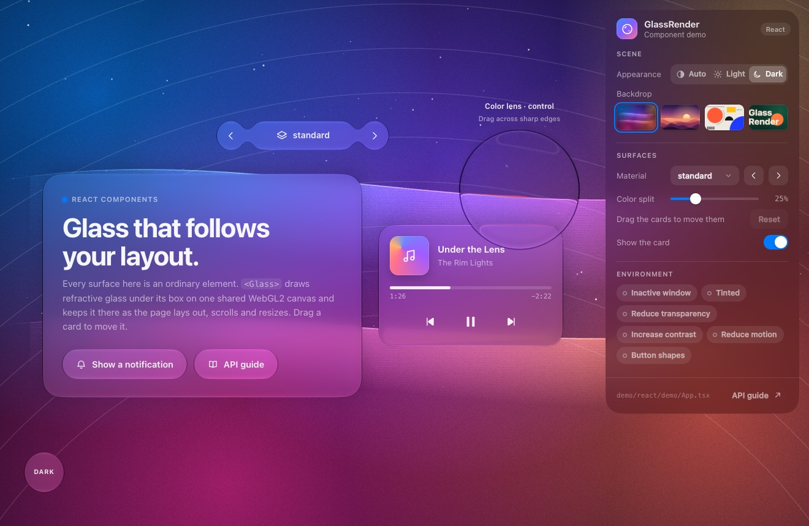
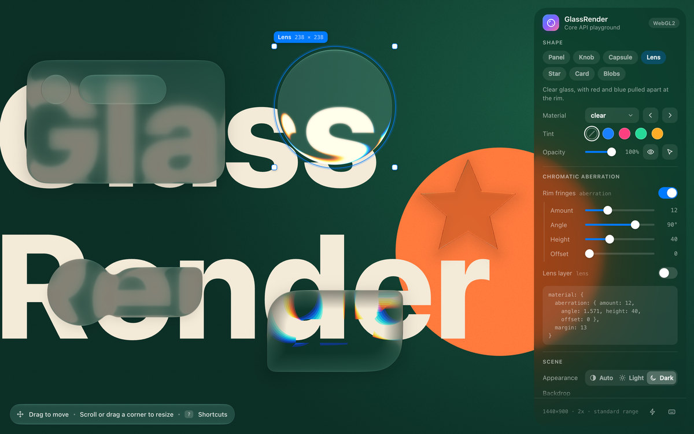
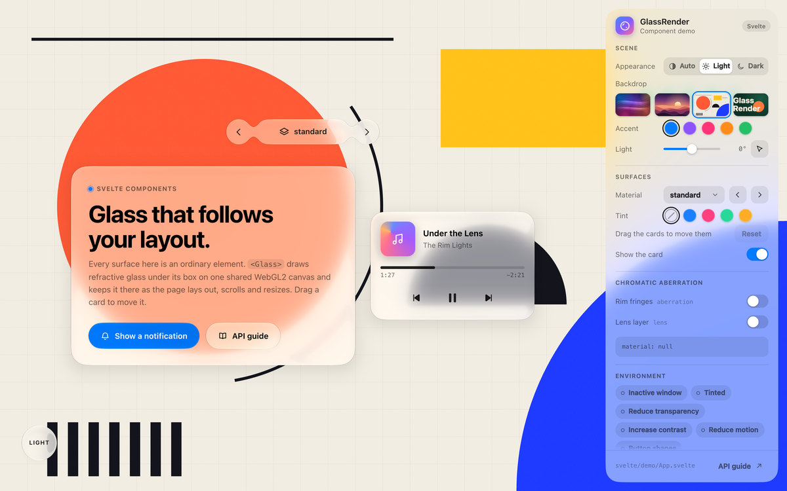

<div align="center">


<br>

**Real-time refractive glass for the web, drawn on a WebGL2 canvas.**

Blur, refraction, rim light, shadow and color fringes over any image, canvas or video,<br>
with React, Svelte, Vue and Solid components that keep the glass under your layout.

The framework components include a built-in backdrop, or you can supply an image, canvas or video. GlassRender does not capture the page: HTML and CSS behind the canvas do not show through it.

[](https://www.npmjs.com/package/glassrender/v/0.1.2-beta)
[](#browser-support)
[](src)
[](package.json)
[](LICENSE)

[Install](#install) · [Quick start](#quick-start) · [Vanilla JS](#vanilla-js) · [Materials](#materials) · [Frameworks](#frameworks) · [Demos](#demos) · [API guide](api.md)

</div>

## Features

Choose a `preset`; the renderer resolves its values for the shape's size, appearance and surroundings.

- **Refraction, blur and light.** Every pixel of glass refracts, blurs and lights the backdrop you supply: an image, a canvas or a playing video.
- **28 built-in materials.** `standard`, `clear`, `menu`, `sidebar`, `dock`, `widget` and more, with size, appearance and environment rules. Some role names share the same profile.
- **Glass that follows the DOM.** `Glass` components for React, Svelte, Vue and Solid track their boxes as the page lays out, scrolls, resizes and animates.
- **Groups and masks.** Neighboring shapes flow into one piece of glass, and any alpha mask becomes an outline.
- **Chromatic aberration.** Control and lens profiles include color separation around their edges. `chromaticAberration` adjusts it from `0` to `1`, with a subtle default of `0.25`.
- **Accessibility settings.** Follows reduced transparency, increased contrast and reduced motion, or set them yourself.
- **HDR pixel input.** Upload encoded-sRGB premultiplied float32 or binary16 pixels directly with `setBackdropPixels()`, retaining a snapshot through context loss.
- **No core runtime dependencies.** One WebGL2 context, recovery from context loss, and float output where supported. Physical HDR presentation depends on browser compositing and display support.

## Materials

Choose `standard` for a frosted surface, `clear` for transparent glass, or a role such as `control`, `menu` or `dock`. Set `chromaticAberration` on a shape, group or canvas to control color separation independently of other optical effects. Profiles respond to size, appearance and environment settings. Some role names share a profile.

Leave `tint` unset, rim-light rotation at `0` and `chromaticAberration` at `1` to use a preset unchanged. The default color-separation multiplier is `0.25`. Geometry, visibility and interaction remain ordinary application options.

```js
import { MATERIALS, getMaterialInfo } from "glassrender/materials";

console.log(MATERIALS.map(material => material.name)); // All 28 names.
console.log(getMaterialInfo("player")?.canonical); // "clear"
```

| Import | Use it for |
| --- | --- |
| `glassrender/core` | `createGlass`, shape/group options and convenience API types. |
| `glassrender/materials` | Preset names, material catalog and snapshot inspection. |
| `glassrender/advanced` | `createRenderer`, numeric helpers, constants and GPU block layout. |
| `glassrender` | The three above without the numeric helpers: `createGlass`, the catalog, `createRenderer` and its constants. |

Older material recipes, raw `material` overrides and the synthetic `prominent` preset are no longer accepted. See the [migration notes](api.md#migrating-older-examples) before adapting an older example.

## Showcase



<p align="center"><sub><b>Component demo</b>: glass under ordinary DOM boxes, a toolbar that merges, cards you can drag, and a notification moved by CSS</sub></p>

<table>
<tr>
<td width="50%"></td>
<td width="50%"></td>
</tr>
<tr>
<td align="center"><sub><b>Core playground</b>: shapes and material profiles</sub></td>
<td align="center"><sub><b>Light appearance</b>: the same demo in Svelte</sub></td>
</tr>
</table>

## Install

GlassRender and its React, Svelte, Vue and Solid adapters are available on npm. The current release is **0.1.2 Beta** (`0.1.2-beta`), published under the `beta` tag.

```sh
npm install glassrender@beta
```

For a framework app, install the core together with the adapter you use:

| Framework | Install command |
| --- | --- |
| React | `npm install glassrender@beta glassrender-react@beta` |
| Svelte | `npm install glassrender@beta glassrender-svelte@beta` |
| Vue | `npm install glassrender@beta glassrender-vue@beta` |
| Solid | `npm install glassrender@beta glassrender-solid@beta` |

The framework itself must already be installed in your app. To pin this release, replace `@beta` with `@0.1.2-beta` on both packages.

| Package | npm |
| --- | --- |
| Core | [glassrender](https://www.npmjs.com/package/glassrender) |
| React adapter | [glassrender-react](https://www.npmjs.com/package/glassrender-react) |
| Svelte adapter | [glassrender-svelte](https://www.npmjs.com/package/glassrender-svelte) |
| Vue adapter | [glassrender-vue](https://www.npmjs.com/package/glassrender-vue) |
| Solid adapter | [glassrender-solid](https://www.npmjs.com/package/glassrender-solid) |

## Quick start

For React, Svelte, Vue or Solid, start with the [framework components](#frameworks). For vanilla JavaScript, add a canvas to your page:

```html
<canvas id="glass" style="display:block;width:100vw;height:100vh"></canvas>
```

Then use this module with your app's bundler:

```js
import { createGlass, DEFAULT_BACKDROP } from "glassrender/core";

const image = new Image();
image.src = DEFAULT_BACKDROP;
await image.decode();

const made = createGlass(document.getElementById("glass"), { backdrop: image });
if (!made.ok) throw new Error(made.error);

const glass = made.value;
const panel = glass.add({ x: 40, y: 40, width: 320, height: 160, radius: 24, preset: "standard" });

// set() changes only what you pass and schedules the next frame.
panel.set({ preset: "clear" });
```

Coordinates are CSS pixels from the top-left corner of the canvas. This core example explicitly loads the built-in SVG; replace it with your own image, canvas or video. `GlassCanvas` components load that backdrop automatically when the prop is omitted.

<details>
<summary><b>The repository browser example</b>, <code>examples/quick-start.html</code></summary>
<br>

```html
<!doctype html>
<html lang="en">
<head>
    <meta charset="utf-8">
    <meta name="viewport" content="width=device-width, initial-scale=1">
    <link rel="icon" href="data:,">
    <title>GlassRender browser quick start</title>
    <style>
        body { margin: 0; font: 16px/1.5 system-ui, sans-serif; }
        canvas { position: fixed; inset: 0; display: block; width: 100vw; height: 100vh; pointer-events: none; }
        main { position: relative; min-height: 100vh; padding: 24px; box-sizing: border-box; display: grid; place-items: center; }
        #panel { width: 320px; max-width: 100%; padding: 32px; box-sizing: border-box; color: var(--glass-foreground); }
        button { width: 100%; min-height: 48px; padding: 12px 16px; border: 0; border-radius: 24px; background: transparent; color: var(--glass-title); font: inherit; cursor: pointer; }
    </style>
</head>
<body>
    <canvas id="glass"></canvas>
    <main>
        <section id="panel">
            <h1>GlassRender</h1>
            <p>Material: <strong data-preset>standard</strong>.</p>
            <button id="switch" type="button">Switch to clear</button>
        </section>
    </main>
    <script type="module">
        import { createGlass, DEFAULT_BACKDROP } from "../dist/core.js";

        const image = new Image();
        image.src = DEFAULT_BACKDROP;
        await image.decode();

        const canvas = document.getElementById("glass");
        const result = createGlass(canvas, { backdrop: image });
        if (!result.ok) throw new Error(result.error);

        const glass = result.value;
        const panel = glass.add({
            x: 0, y: 0, width: 0, height: 0,
            radius: 24, preset: "standard",
        }).follow(document.getElementById("panel"));
        const button = document.getElementById("switch");
        glass.add({ x: 0, y: 0, width: 0, height: 0, radius: 24, preset: "control" }).follow(button);
        let preset = "standard";
        button.addEventListener("click", () => {
            preset = preset === "standard" ? "clear" : "standard";
            panel.set({ preset });
            document.querySelector("[data-preset]").textContent = preset;
            button.textContent = "Switch to " + (preset === "standard" ? "clear" : "standard");
        });
        window.addEventListener("pagehide", () => glass.destroy(), { once: true });
    </script>
</body>
</html>
```

This standalone repository example imports the locally built `dist/` module. Follow [Run the repository demos](#run-the-repository-demos), then open http://127.0.0.1:5173/examples/quick-start.html.

</details>

The **[API guide](api.md)** covers options and defaults, all 28 presets, groups, masks, framework events, material metadata and the low-level renderer.

## Vanilla JS

The core works directly with JavaScript and DOM elements. No framework adapter is needed. Install `glassrender@beta` and use this in a module built by your app's bundler:

```js
import { createGlass } from "glassrender/core";

const image = new Image();
image.src = "/wallpaper.jpg";
await image.decode();

const canvas = document.getElementById("glass");
const element = document.getElementById("panel");
if (!canvas || !element) throw new Error("The canvas and panel elements are required.");
const result = createGlass(canvas, { backdrop: image });
if (!result.ok) throw new Error(result.error);

const glass = result.value;
const panel = glass.add({
    x: 0, y: 0, width: 0, height: 0,
    preset: "standard", radius: 24,
}).follow(element);

// Updates schedule their own frame.
panel.set({ tint: [0.2, 0.5, 1, 0.3] });
window.addEventListener("pagehide", () => glass.destroy(), { once: true });
```

The page supplies the canvas and panel, with CSS sizes and positioning:

```html
<canvas id="glass" style="position:fixed;inset:0;width:100vw;height:100vh;pointer-events:none"></canvas>
<section id="panel" style="position:relative;width:320px;padding:24px;color:var(--glass-foreground)">My panel</section>
```

For plain HTML without a bundler, use a pinned CDN import inside `<script type="module">`:

```js
import { createGlass } from "https://cdn.jsdelivr.net/npm/glassrender@0.1.2-beta/dist/core.js";
```

Serve the page over HTTP and provide a backdrop image, canvas or video. `follow(element)` measures the element again after resizes, scrolling, DOM changes, image and font loads and CSS transitions; `follow(element, true)` also measures it on every frame for CSS animations. Call `glass.destroy()` when your app removes the scene. The complete browser example above uses the same core API.

## Frameworks

| Package | Version | Requires |
| --- | --- | --- |
| [`glassrender-react`](https://www.npmjs.com/package/glassrender-react) | 0.1.2 Beta | React 18 or later |
| [`glassrender-svelte`](https://www.npmjs.com/package/glassrender-svelte) | 0.1.2 Beta | Svelte 5 |
| [`glassrender-vue`](https://www.npmjs.com/package/glassrender-vue) | 0.1.2 Beta | Vue 3.4 or later |
| [`glassrender-solid`](https://www.npmjs.com/package/glassrender-solid) | 0.1.2 Beta | Solid 1.9 or later |

`GlassCanvas` manages the canvas and render loop. Each `Glass` inside it follows its DOM box. Omit `backdrop` to use the built-in SVG background; supply a URL, image, canvas or video to use your own, or `null` to clear it.

Install the core and your adapter in an existing framework app, then use a component below.

<details open>
<summary><b>React</b></summary>
<br>

```sh
npm install glassrender@beta glassrender-react@beta
```

Use this as `App.tsx`:

```tsx
import { Glass, GlassCanvas } from "glassrender-react";

export default function App() {
    return (
        <GlassCanvas>
            <Glass preset="standard" radius={24} style={{ width: 320, padding: 24 }}>
                <h1>GlassRender</h1>
                <p>Hello, glass.</p>
            </Glass>
        </GlassCanvas>
    );
}
```

</details>

<details>
<summary><b>Svelte</b></summary>
<br>

```sh
npm install glassrender@beta glassrender-svelte@beta
```

Use this as `App.svelte`:

```svelte
<script lang="ts">
    import { Glass, GlassCanvas } from "glassrender-svelte";
</script>

<GlassCanvas>
    <Glass preset="standard" radius={24} style="width: 320px; padding: 24px;">
        <h1>GlassRender</h1>
        <p>Hello, glass.</p>
    </Glass>
</GlassCanvas>
```

</details>

<details>
<summary><b>Vue</b></summary>
<br>

```sh
npm install glassrender@beta glassrender-vue@beta
```

Use this as `App.vue`:

```vue
<script setup lang="ts">
import { Glass, GlassCanvas } from "glassrender-vue";
</script>

<template>
    <GlassCanvas>
        <Glass preset="standard" :radius="24" style="width: 320px; padding: 24px;">
            <h1>GlassRender</h1>
            <p>Hello, glass.</p>
        </Glass>
    </GlassCanvas>
</template>
```

</details>

<details>
<summary id="solid"><b>Solid</b></summary>
<br>

```sh
npm install glassrender@beta glassrender-solid@beta
```

Use this as `App.tsx` with your Solid JSX compiler:

```tsx
import { Glass, GlassCanvas } from "glassrender-solid";

export default function App() {
    return (
        <GlassCanvas>
            <Glass preset="standard" radius={24} style={{ width: "320px", padding: "24px" }}>
                <h1>GlassRender</h1>
                <p>Hello, glass.</p>
            </Glass>
        </GlassCanvas>
    );
}
```

</details>

Change `preset` to select a material. Add `GlassGroup` to merge neighboring shapes. Use `fixed={false}` (`:fixed="false"` in Vue) to keep the canvas inside a container with a defined size. The [API guide](api.md#framework-component-options) lists all props, and each repository [quick-start demo](#run-the-repository-demos) includes a button that switches materials.

## Demos

| Demo | Source | Address |
| --- | --- | --- |
| Showcase reel | [`examples/showcase.html`](examples/showcase.html) | http://127.0.0.1:5173/examples/showcase.html |
| Renderer example | [`examples/renderer.html`](examples/renderer.html) | http://127.0.0.1:5173/examples/renderer.html |
| Core playground | [`examples/index.html`](examples/index.html) | http://127.0.0.1:5173/examples/ |
| React | [`demo/react/demo/App.tsx`](demo/react/demo/App.tsx) | http://127.0.0.1:5175/ |
| Svelte | [`demo/svelte/demo/App.svelte`](demo/svelte/demo/App.svelte) | http://127.0.0.1:5174/ |
| Vue | [`demo/vue/demo/App.vue`](demo/vue/demo/App.vue) | http://127.0.0.1:5176/ |
| Solid | [`demo/solid/demo/App.tsx`](demo/solid/demo/App.tsx) | http://127.0.0.1:5177/ |

The showcase reel uses built-in presets and ordinary RGBA tints; run it from the source above to reproduce the banner. The playground offers the built-in material catalog, shape kinds and environment settings. Its optical values come from the selected preset. The React, Svelte and Vue demos show draggable cards and a `control` lens. Move the lens across sharp backdrop edges to see its built-in color separation. The Solid demo shows reactive material and opacity controls with a merged toolbar. The `standard` and `clear` profiles do not add color separation. Each framework also has `quick-start.html`; `npm run build:demo` includes both pages in `demo-dist/`. The quick starts switch between built-in `standard` and `clear` profiles using a real button.

### Run the repository demos

Clone the repository to run the showcase and playground. The demo toolchain needs Node.js 22.12 or later and npm:

```sh
git clone https://github.com/Feralthedogg/GlassRender.git
cd GlassRender
npm ci
npm run build
npm run demo
```

The core examples are served at http://127.0.0.1:5173/examples/. Run a framework demo from a separate terminal in the repository root:

```sh
# React: http://127.0.0.1:5175/
npm --prefix demo/react ci
npm --prefix demo/react run demo -- --host 127.0.0.1 --strictPort

# Svelte: http://127.0.0.1:5174/
npm --prefix demo/svelte ci
npm --prefix demo/svelte run demo -- --host 127.0.0.1 --strictPort

# Vue: http://127.0.0.1:5176/
npm --prefix demo/vue ci
npm --prefix demo/vue run demo -- --host 127.0.0.1 --strictPort

# Solid: http://127.0.0.1:5177/
npm --prefix demo/solid ci
npm --prefix demo/solid run demo -- --host 127.0.0.1 --strictPort
```

Each framework server also provides `/quick-start.html`. These repository commands run local demo sources; the npm commands in [Install](#install) are for adding GlassRender to your own app.

## Tests

```sh
npm test                 # type-checked build and the Node tests
npm run test:browser     # functional tests in headless Chrome
npm run test:adapters    # Canvas and input tests (after `npm ci` in each demo folder)
npm run bench            # frame cost of the benchmark scenes
```

The browser tests and the benchmark start Chrome from its usual install location or from the `CHROME` environment variable. Extra Chrome switches come from `CHROME_FLAGS`. On a machine without a GPU, `--use-angle=swiftshader --enable-unsafe-swiftshader` selects the software renderer, which is much slower. Continuous integration runs the Node tests, a subset of the browser tests on that renderer, and the adapter type checks and builds.

## Project layout

```text
src/         built-in profile data, core API, catalog and WebGL2 renderer
demo/react/  glassrender-react and React demo
demo/svelte/ glassrender-svelte and Svelte demo
demo/vue/    glassrender-vue and Vue demo
demo/solid/  glassrender-solid and Solid demo
examples/    the core playground, the quick start and the assets the demos share
test/        Node tests, and functional and adapter tests run in headless Chrome
bench/       benchmark scenes and their headless Chrome runner
tools/       the headless Chrome driver shared by tests and benchmark
api.md       the API guide
```

## Browser support

GlassRender runs wherever WebGL2 does. Mask outlines need `EXT_color_buffer_float`, and extended-range output needs a screen and a browser that support it. When WebGL2 is missing, `createGlass` returns an error instead of throwing.

## License

[MIT](LICENSE) © 2026 Feralthedogg

The photographs in the reel are from Pexels, under the [Pexels License](https://www.pexels.com/license/): [monstera leaves](https://www.pexels.com/photo/dark-green-leaves-of-monstera-20432992/) by Balázs Gábor and [California poppies](https://www.pexels.com/photo/close-up-of-orange-poppies-under-blue-sky-18591317/) by Soly Moses.
